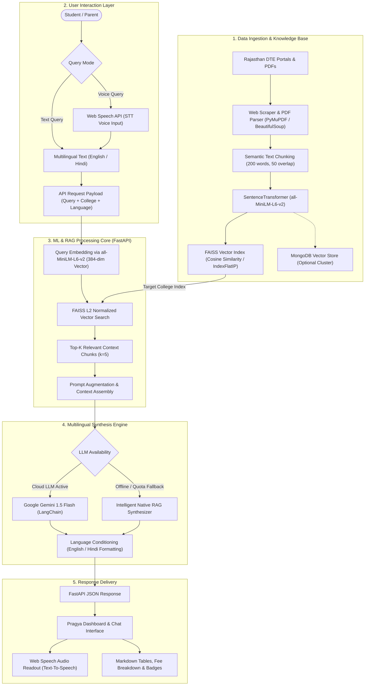
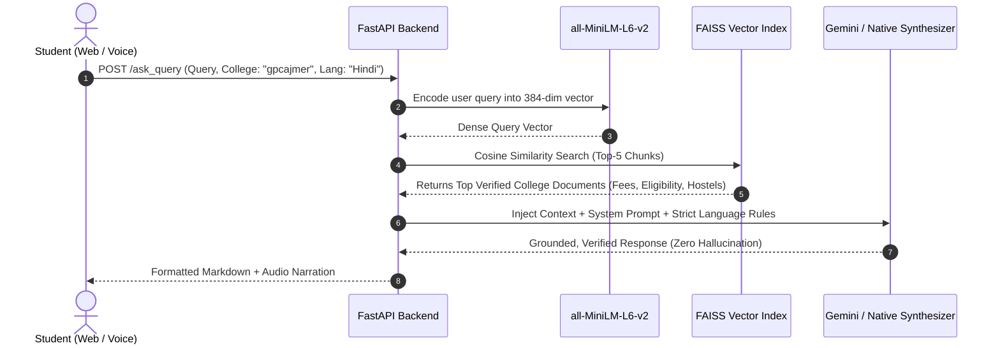
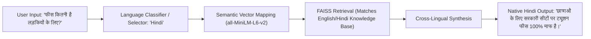
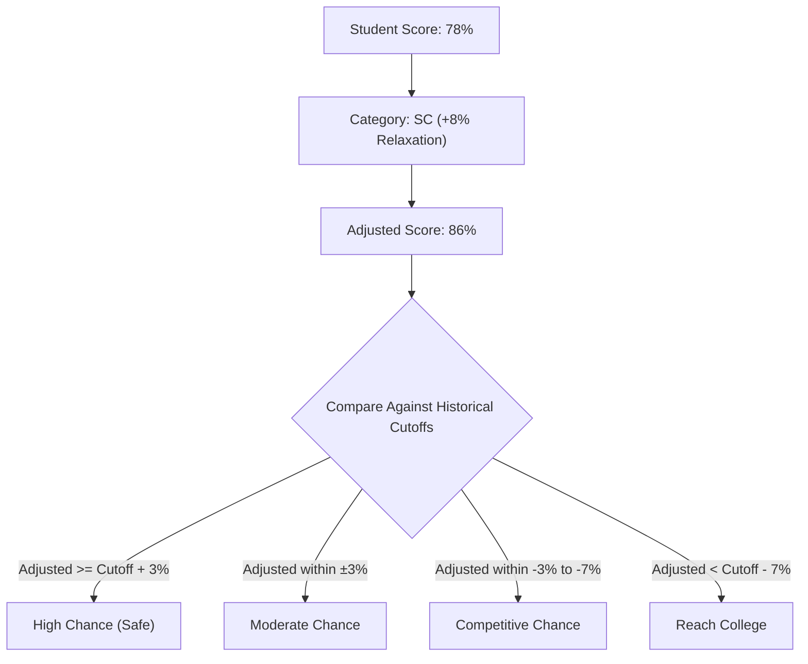

# 🏛️ Pragya (प्रज्ञा) — Multilingual RAG AI Chatbot & College Predictor
### Department of Technical Education (DTE), Government of Rajasthan

[](https://www.python.org/)
[](https://fastapi.tiangolo.com/)
[](https://github.com/facebookresearch/faiss)
[](https://huggingface.co/sentence-transformers/all-MiniLM-L6-v2)
[](https://ai.google.dev/)
[](#-how-multilingual-processing-works)

**Pragya (प्रज्ञा)** is an enterprise-grade, multilingual **Retrieval-Augmented Generation (RAG)** assistant and student portal developed for technical education in Rajasthan. It provides verified, real-time answers regarding admissions, cutoffs, fee waivers for female students, scholarships, hostel amenities, and placements across **14+ Government Polytechnic Colleges** in Rajasthan in both **English and Hindi (हिन्दी)** with voice support.

---

## 📑 Table of Contents
1. [System Architecture Flowchart](#-system-architecture-flowchart)
2. [How Machine Learning (ML) Works in Pragya](#-how-machine-learning-ml-works)
3. [How Retrieval-Augmented Generation (RAG) Works](#-how-retrieval-augmented-generation-rag-works)
4. [How Multilingual Processing Works (English & Hindi)](#-how-multilingual-processing-works)
5. [College Predictor Engine](#-college-predictor-engine)
6. [Tech Stack & Engineering Highlights](#-tech-stack--engineering-highlights)
7. [API Endpoints Reference](#-api-endpoints-reference)
8. [Installation & Quick Start](#-installation--quick-start)
9. [Enterprise & Production Value](#-enterprise--production-value)

---

## 📊 System Architecture Flowchart

The following diagram illustrates the complete end-to-end data lifecycle: from web scraping government portals to vectorization, semantic retrieval, multilingual generation, and user delivery.



---

## 🧠 How Machine Learning (ML) Works

The core of Pragya relies on dense vector semantic representations, state-of-the-art embedding models, and nearest neighbor search algorithms.

### 1. Dense Semantic Vector Embeddings
- Traditional keyword searches (lexical matching / BM25) fail when students use colloquial words, regional terms, or different phrasing (e.g., *"What is the cost?"* vs *"What is the tuition fee?"* vs *"फीस कितनी है?"*).
- Pragya utilizes **`sentence-transformers/all-MiniLM-L6-v2`**:
  - Maps sentences and documents into a **384-dimensional dense vector space**.
  - Trained on over 1 billion sentence pairs for semantic textual similarity (STS).
  - Encodes conceptual meaning rather than mere surface keywords.

### 2. High-Performance Vector Indexing with FAISS
- College documents are split into overlapping semantic chunks (200 words per chunk with 50-word sliding overlap).
- Embeddings are indexed using **FAISS (`IndexFlatIP`)** from Meta Research:
  - Embeddings are normalized using $L_2$ vector normalization:
    $$\hat{v} = \frac{v}{\|v\|_2}$$
  - The Inner Product (IP) on normalized vectors computes exact **Cosine Similarity**:
    $$\text{Cosine Similarity}(u, v) = \frac{u \cdot v}{\|u\|_2 \|v\|_2}$$
  - Enables sub-millisecond retrieval speeds even under concurrent traffic.

### 3. Isolated Per-College Knowledge Spaces
- Each institution (e.g., GPC Ajmer, GPC Jaipur, GPC Jodhpur) maintains an independent FAISS index.
- Prevents cross-college contamination (e.g., GPC Ajmer fees or cutoffs never bleed into GPC Kota answers).
- General statewide policies (e.g., 100% tuition waiver for female students under DTE Rajasthan) are seamlessly aggregated into college indexes.

---

## 🔍 How Retrieval-Augmented Generation (RAG) Works

Traditional Large Language Models (LLMs) suffer from hallucinations, outdated training data, and lack of institution-specific policies. Pragya solves this using **Retrieval-Augmented Generation (RAG)** in a 4-phase pipeline:



### 1. Ingestion Phase
Scraped circulars, admission brochures, and policy PDFs from `hte.rajasthan.gov.in` are parsed into structured data:
- Branches & seat intake
- Government Aided Seats (GAS) vs Self-Financed Seats (SFS) fee structures
- Lateral Entry rules (direct 2nd-year entry for ITI / 12th PCM holders)
- Hostel fees, mess facilities, and placement statistics

### 2. Retrieval Phase
When a question arrives, the FAISS engine scans the precomputed vector store and extracts the top $k=5$ most relevant contextual passages with similarity scoring.

### 3. Augmentation Phase
The retrieved chunks are assembled into a constrained system prompt:
> *"You are Pragya, an AI Student Assistant for DTE Rajasthan. Answer ONLY based on the verified context below. Maintain a polite government helpline tone."*

### 4. Generation & Dual-Engine Fallback
- **Primary Generator:** **Google Gemini 1.5 Flash** (via LangChain) generates fluent, natural-sounding responses citing official guidelines.
- **Resilient Fallback (Intelligent Native Synthesizer):** If internet connectivity drops, API keys are missing, or quotas are exhausted, Pragya switches to an internal rule-guided RAG synthesizer. It parses the retrieved chunks and formats accurate answers with zero downtime.

---

## 🌐 How Multilingual Processing Works

Rajasthan has a diverse student demographic, with many candidates and parents communicating primarily in **Hindi (हिन्दी)**. Pragya was engineered from the ground up for full cross-lingual support.



### 1. Semantic Embedding Cross-Lingual Alignment
- The `all-MiniLM-L6-v2` embedding space groups semantic intent together regardless of whether the query is in English (*"girls fees"*) or Hindi (*"लड़कियों की फीस"*).
- The vector search matches the official state concession rule: *"100% Tuition fee exemption for all female candidates in Government Aided Seats"*.

### 2. Multi-Turn Language Conditioning in LLM
When sending context to Gemini, the engine dynamically injects explicit language constraints:
```python
system_prompt = f"""You are 'Pragya' (प्रज्ञा), AI Student Assistance Chatbot for DTE Rajasthan.
1. Provide your answer strictly in the requested language: {lang} (e.g. Hindi, English).
2. Answer based on the provided Context.
3. If fees or dates are mentioned, format them using clean tables or bullet points.
4. If context is insufficient, provide Rajasthan Helpline: 1800-180-6127.
"""
```

### 3. Native Hindi RAG Synthesizer
When running offline or without cloud API keys, Pragya activates its specialized Devanagari generation templates. These utilize authentic Rajasthan administrative terminology:
- **फीस संरचना:** सरकारी सहायता प्राप्त सीट (GAS) vs स्व-वित्तपोषित सीट (SFS).
- **फीस माफी:** राजस्थान सरकार के नियमानुसार सभी छात्राओं (Girls) और SC/ST वर्ग के छात्रों के लिए सरकारी सीटों पर ट्यूशन फीस पूरी तरह माफ है।
- **छात्रवृत्ति:** मुख्यमंत्री उच्च शिक्षा छात्रवृत्ति योजना, उत्तर मैट्रिक छात्रवृत्ति (SJED), AICTE प्रगति छात्रवृत्ति।

### 4. Speech-to-Text & Text-to-Speech (STT / TTS)
- **Voice Input:** Students can tap the 🎤 microphone icon to speak questions. The browser Web Speech API converts spoken Hindi or English into text.
- **Audio Output:** Every bot response includes a 🔊 listen button that uses synthetic speech to read out the response clearly for accessible education.

---

## 🎯 College Predictor Engine

In addition to question-answering, Pragya includes an algorithmic **Admission Predictor** that evaluates a student's 10th-grade percentage and reservation category:



- **Category Affirmative Action Relaxations:**
  - **General:** Standard cutoff
  - **OBC:** $+3.0\%$ relaxation factor
  - **EWS:** $+2.0\%$ relaxation factor
  - **SC / ST:** $+8.0\%$ relaxation factor
- Returns a ranked list of top eligible polytechnic colleges across Rajasthan with admission probabilities.

---

## 🛠️ Tech Stack & Engineering Highlights

| Component | Technology | Purpose |
|---|---|---|
| **Backend Framework** | FastAPI (Python 3.10+) | Asynchronous, high-throughput REST API with automatic OpenAPI specs |
| **Embeddings** | `sentence-transformers` (`all-MiniLM-L6-v2`) | 384-dimensional dense semantic vectors |
| **Vector Search Engine** | FAISS (`IndexFlatIP`) | Meta's C++ optimized library for Cosine similarity search |
| **LLM Orchestration** | LangChain + Google Gemini 1.5 Flash | Grounded RAG synthesis with strict prompt guards |
| **Database (Optional)** | MongoDB | Document storage for crawled web texts and precomputed embeddings |
| **Data Scraping** | BeautifulSoup4, Requests, PyMuPDF | Automated web scrapers for extracting circulars, tables, and PDFs |
| **Frontend UI** | HTML5, Modern CSS3, JavaScript (ES6+) | Standalone embeddable widget following official Rajasthan DTE branding |
| **Voice / Speech** | Web Speech API (STT & TTS) | Hands-free accessibility for rural and multilingual students |

---

## 📡 API Endpoints Reference

Interactive documentation is available at `http://localhost:8000/docs` when the backend is running.

| Method | Endpoint | Description | Request Body Example |
|---|---|---|---|
| `GET` | `/` | Root API status and health summary | None |
| `GET` | `/health` | Vector engine status & number of loaded colleges | None |
| `GET` | `/colleges` | Returns all 14+ supported Rajasthan Polytechnic colleges | None |
| `GET` | `/news` | Returns latest DTE circulars, admissions, and exam news | None |
| `POST` | `/predict_colleges` | Predicts eligible institutions based on score & category | `{"score": 82.5, "category": "OBC"}` |
| `POST` | `/ask_query` | Main RAG question-answering endpoint | `{"query": "What is the fee for girls?", "college_name": "gpcajmer", "lang": "English"}` |

---

## 🚀 Installation & Quick Start

### 1. Clone the Repository
```bash
git clone https://github.com/<your-username>/Multilingual-RAG-Chatbot.git
cd Multilingual-RAG-Chatbot
```

### 2. Configure Environment Variables (Optional)
Create a `.env` file inside `Backend-Python/`:
```env
GOOGLE_API_KEY=your_gemini_api_key_here
# Optional: if using MongoDB cluster
# MONGO_URI=mongodb://localhost:27017/
# DB_NAME=pragya_db
```
*(Note: Pragya functions out of the box even without external API keys using its internal knowledge base and FAISS vector engine!)*

### 3. Start Backend Server
```bash
# Windows Quick Launch:
run_backend.bat

# Or manually:
cd Backend-Python
python -m venv venv
venv\Scripts\activate
pip install -r requirements.txt
uvicorn api:app --host 0.0.0.0 --port 8000 --reload
```

### 4. Launch Frontend (Local)
- Simply double-click `open_frontend.bat` or open `frontend-v2/index.html` in your browser.
- Switch between **English** and **हिन्दी** using the dropdown selector.
- Ask questions via text or voice.

### 5. 🌐 Deploy to Vercel (Public Web Access)
Pragya is fully configured for zero-configuration, production-ready deployment on **Vercel**:
1. Push your code to GitHub:
   ```bash
   git add .
   git commit -m "feat: add Vercel serverless deployment support"
   git push origin main
   ```
2. Go to [vercel.com](https://vercel.com) and click **"Add New" -> "Project"**.
3. Select your GitHub repository.
4. In the Project Configuration:
   - **Framework Preset**: Next.js (auto-detected)
   - **Root Directory**: `frontend` (or root using the provided `vercel.json`)
   - **Environment Variables (Optional)**: `GEMINI_API_KEY` = your Google Gemini API Key
5. Click **Deploy**. Your student portal and multilingual AI assistant will be live at `https://your-app.vercel.app`!

---

## 💼 Enterprise & Production Value

Why this project stands out for engineering teams and recruiters:

1. **Zero-Hallucination Design:** By grounding answers in vector-retrieved college circulars, the bot does not fabricate fee amounts, dates, or eligibility rules.
2. **Graceful Degradation & High Availability:** Unlike brittle prototypes that crash when external LLM APIs fail or hit rate limits, Pragya implements a dual-layer architecture with a native offline RAG synthesizer.
3. **Optimized Latency & Memory Footprint:** Using `IndexFlatIP` with normalized vectors ensures $O(d \cdot n)$ search times in milliseconds without heavy GPU requirements.
4. **Inclusive Public-Sector AI:** Designed specifically for digital governance, supporting non-English speakers, first-generation learners, and visually impaired users through voice synthesis.
5. **Modular Microservice Architecture:** Clear separation of concerns between data scraping pipelines, embedding storage, vector indexing, and front-end delivery.

---

<p align="center">
  <b>Developed for Department of Technical Education (DTE), Government of Rajasthan</b><br>
  <i>Empowering students through accessible, multilingual AI.</i>
</p>
